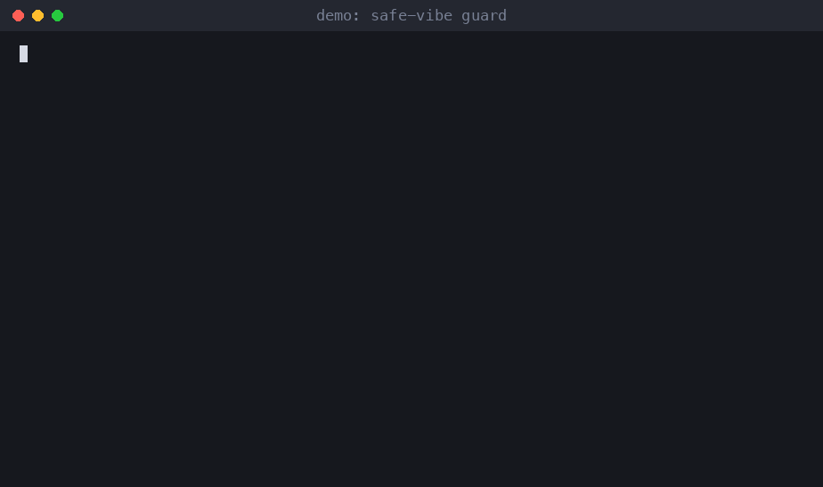

# safe-vibe

**Claude Code can't wipe your prod, steal your focus, or rewrite your git history. One command.**



[](tests)
[](#requirements)
[](#requirements)
[](LICENSE)

Three small Python hooks for [Claude Code](https://docs.claude.com/en/docs/claude-code/hooks). They run before every shell command the agent wants to execute and stop the few that cause real damage.

Install it as a Claude Code plugin. The plugin ships the guard and pull-before-push hooks and nothing else:

```text
/plugin marketplace add nickspiz/safe-vibe
/plugin install safe-vibe@safe-vibe
```

Prefer a manual install? `install.sh` and `installer.py` are a separate, non-plugin path. They are not part of what the plugin runs. See [Install without the plugin](#install-without-the-plugin).

## Example prompts

- "Run `git reset --hard` in this repo." The hook blocks it and tells Claude why.
- "Delete the build folder inside the project." Allowed, because it is inside the project.
- "Push my branch." If a teammate pushed first, the hook rebases your work on top of theirs, then pushes.

## What you get

| Hook | What it does |
|---|---|
| `guard.py` | Blocks destructive commands: `DROP` and `TRUNCATE`, `DELETE` with no `WHERE`, `rm -rf` outside the project, `git push --force` to `main`, `git reset --hard`, `docker compose down`, `terraform destroy`, `kubectl delete`. You can add your own patterns and prod hostnames. |
| `pull_before_push.py` | Before `git push`, fetches. If the remote is ahead it runs `git pull --rebase --autostash`. On a conflict it aborts the rebase, leaves your files as they were, and tells the agent why the push did not go out. |
| `no_focus_steal.py` | macOS. Blocks `open`, `osascript ... activate`, `say`, and browsers started with a visible window, so the agent stops pulling windows over what you are doing. |

When a command is blocked, the agent gets a plain-English message with three parts: what was blocked, why, and what to do instead.

## Demo

Output from the hooks, run by hand (paths shortened):

```text
$ psql -c "DELETE FROM users;"
safe-vibe blocked this command.
  What:    DELETE FROM without WHERE
  Why:     it deletes every row in the table.
  Instead: Add a WHERE clause, run a SELECT with the same WHERE first, or ask the user.

$ git push --force origin main
safe-vibe blocked this command.
  What:    git push --force to main
  Why:     it rewrites shared history, and teammates' clones and deploys will not match afterwards.
  Instead: Push a new commit, or push a feature branch. If history really must change, ask the user.

$ rm -rf ~/Documents/old-site
safe-vibe blocked this command.
  What:    rm -r ~/Documents/old-site  (resolves to /Users/you/Documents/old-site)
  Why:     it is outside the project folder (/Users/you/code/app) or is the project folder itself.
  Instead: Delete only paths inside the project, or ask the user to run this one.

$ open -a Safari
safe-vibe blocked this command.
  What:    open -a Safari
  Why:     on macOS `open` brings the app or browser window to the front and interrupts whatever you are doing.
  Instead: Print the path or URL for the user instead. If you must launch it, use `open -g` (stays in the background).
```

And the pull-before-push hook, when a teammate pushed while you were working:

```text
$ git push
safe-vibe: the remote had 2 new commit(s). I rebased your work on top of them before pushing.
```

If the rebase would conflict, you get this instead, and your tree is untouched:

```text
safe-vibe blocked this command.
  What:    git push (remote is ahead and the rebase conflicts)
  Why:     1 commit(s) on origin/main touch the same lines as yours. I aborted the rebase, so your files and commits are exactly as they were.
  Instead: Run `git pull --rebase`, resolve the conflicted files together with the user, then push again. Never force-push to get around this.
```

## Install without the plugin

This path does not use the plugin system. `install.sh` runs `installer.py`, which edits your Claude Code settings file.

```bash
# for your user, all projects
curl -fsSL https://raw.githubusercontent.com/nickspiz/safe-vibe/main/install.sh | bash

# or clone first, then pick a scope
git clone https://github.com/nickspiz/safe-vibe && cd safe-vibe
./install.sh                    # user scope: ~/.claude/settings.json
./install.sh --project .        # one project: ./.claude/settings.json
./install.sh --no-focus         # skip the macOS focus hook

./uninstall.sh                  # removes only the safe-vibe entries
```

The installer copies the hooks to `~/.claude/safe-vibe/hooks/` (or `<project>/.claude/safe-vibe/hooks/`), writes one `PreToolUse` entry with matcher `Bash`, and drops a starter `safe-vibe.toml` if you have none. It edits `~/.claude/settings.json` (or `<project>/.claude/settings.json`). Before it writes, it saves `settings.json.safe-vibe-backup-<timestamp>` next to it. If your settings file is not valid JSON, it stops and changes nothing. Your other hooks and settings are kept.

Restart Claude Code afterwards, or open `/hooks` to check.

## What it will NOT touch

- Your other settings and hooks. Only entries that point at `safe-vibe/hooks/` are added or removed.
- Your files. The hooks never delete, move, or edit anything. They read the command and say yes or no. The one exception is `pull_before_push.py`, which runs `git fetch`, and `git pull --rebase --autostash` when the remote is ahead.
- Anything that is not the Bash tool. Read, Write and Edit calls pass straight through.
- Force pushes to other branches. `git push --force origin my-feature` is allowed. Only protected branches are blocked.
- Read-only commands. `SELECT`, `git status`, `kubectl get`, `terraform plan`, `docker compose up` and `stop` all run as normal.
- Text that only mentions a dangerous command. `git commit -m "never DROP TABLE in prod"` and `grep "DROP TABLE" migrations/` are fine.
- Your session, when something breaks. If a hook crashes or gets a payload it does not understand, it lets the command through. A bug here should never lock you out.
- Anything over the network. No telemetry, no downloads at runtime. The only network access is the `git fetch` in the pull-before-push hook.

safe-vibe matches patterns in the command text. It is not a sandbox, so a script that builds its command in a variable can slip past it. Keep permission prompts and backups for anything that matters.

## Configure

Create `safe-vibe.toml` in your project (or `.claude/safe-vibe.toml`), or `~/.config/safe-vibe/safe-vibe.toml` for every project. Project settings are added on top of the global ones. A `safe-vibe.json` with the same keys works too, and is the only choice on Python older than 3.11.

```toml
[guard]
protected_branches = ["main", "master", "release"]
disable = []                    # built-in rule ids to switch off
allow = ['^docker compose -f docker-compose\.test\.yml down']
rm_safe_paths = ["~/scratch"]   # rm -r is fine here, on top of /tmp

[prod]
# Hosts an agent should never touch. ssh, scp, rsync, psql, mysql,
# docker and kubectl commands that mention them are blocked.
hosts = ["prod.example.com", "10.0.0.5"]

[[rule]]
id = "no-deploy-script"
pattern = 'npm run deploy|\./deploy\.sh'
what = "the deploy script"
why = "deploys go out through CI here, not from a laptop."
instead = "Push to main and watch the pipeline, or ask the user."

[focus]
disable = []                    # open, say, osascript, headed
allow = []
```

Built-in rule ids: `sql-drop`, `sql-truncate`, `sql-delete`, `terraform-destroy`, `compose-down`, `kubectl-delete`, `git-reset-hard`, `git-force-push`, `rm-outside-project`, `prod-host`.

To turn everything off for one session, start Claude Code with `SAFE_VIBE_OFF=1` in the environment. The agent cannot set that for you, because it has to be present before the hook starts.

## FAQ

**Will it slow Claude Code down?**
Each hook is a short Python process that reads one command. On my machine the guard takes about 35 ms per command. The pull-before-push hook adds a `git fetch` when you push.

**Claude says a command was blocked. What now?**
Read the "Instead" line, it usually has a safer route. If you really want the command, run it yourself in your terminal, or add an `allow` pattern for it in your config.

**Does it work with other agents?**
The hooks follow the Claude Code hook format: JSON on stdin, exit code 2 to block. Any agent that uses the same convention can call them.

**Why does `rm -rf /tmp/foo` work but `rm -rf ~/foo` not?**
`/tmp` is scratch space. Everything else has to be inside the project folder, which is the directory Claude Code was started in (or `CLAUDE_PROJECT_DIR`). Add more scratch folders with `rm_safe_paths`.

**Why was `rm -rf $DIR` blocked?**
The hook cannot see what `$DIR` holds, and an empty variable turns it into `rm -rf /`. Spell out the path.

**Does the focus hook matter on Linux?**
It is built for macOS. The installer skips it elsewhere unless you pass `--with-focus`.

**How do I know it is active?**
Run `/hooks` in Claude Code, or ask it to run `git reset --hard` in a scratch repo.

## Requirements

Python 3.9 or newer and git. No packages. TOML config needs Python 3.11+; on older versions use JSON.

## Tests

```bash
pip install pytest
pytest
```

The tests run each hook as a subprocess against throwaway git repos and a temporary `HOME`, so they never touch your real Claude settings.

## Questions and ideas

Have a question or an idea? Start a [discussion](https://github.com/nickspiz/safe-vibe/discussions). For bugs, open an [issue](https://github.com/nickspiz/safe-vibe/issues/new/choose). See [CONTRIBUTING.md](CONTRIBUTING.md) before sending a pull request.

## Privacy

What the plugin reads, writes, runs and sends:

- **Runs:** two Python scripts before each Bash command Claude Code wants to run, `hooks/guard.py` and `hooks/pull_before_push.py`, started with `python3`. The guard also runs `git symbolic-ref` to learn the current branch. Before a `git push`, `pull_before_push.py` runs `git fetch`, and `git pull --rebase --autostash` if the remote is ahead. That can change your working tree. On a conflict it aborts the rebase.
- **Reads:** the command text Claude Code passes in, the environment variables `SAFE_VIBE_OFF`, `SAFE_VIBE_CONFIG`, `CLAUDE_PROJECT_DIR` and `HOME`, and the optional config files `safe-vibe.toml` or `safe-vibe.json` (project, `.claude/`, or `~/.config/safe-vibe/`).
- **Writes:** nothing. The hooks never create or edit files. The only change to your files is the rebase above.
- **Sends:** nothing to the author or anyone else. The only network access is the `git fetch` to your own remote. No telemetry, no downloads at runtime.
- **Not part of the plugin:** `install.sh`, `uninstall.sh`, `installer.py` and `no_focus_steal.py`. `install.sh` downloads files from github.com when run through `curl | bash`, and `installer.py` edits `~/.claude/settings.json` after making a backup. Neither runs unless you run it yourself.

## Support

Questions or bugs: [GitHub Issues](https://github.com/nickspiz/safe-vibe/issues) or hello@nickspiz.com.

## License

MIT
